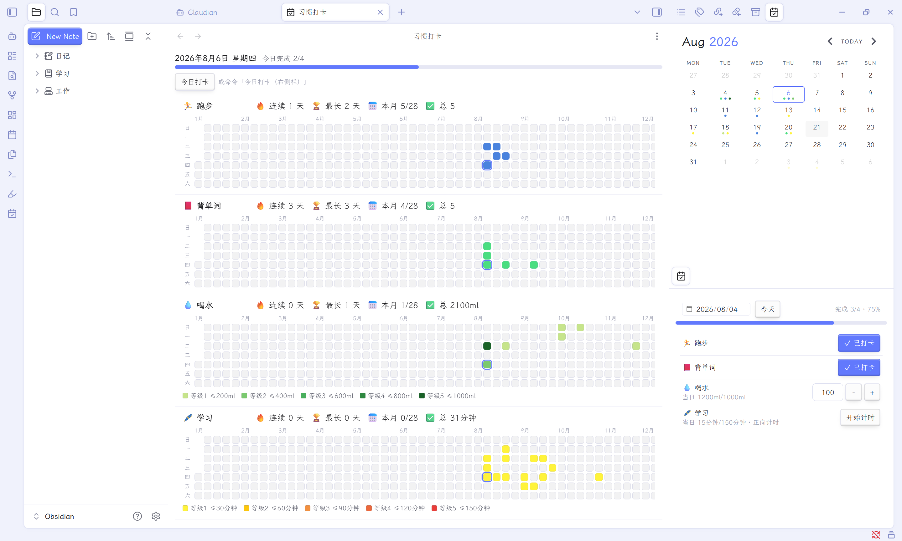
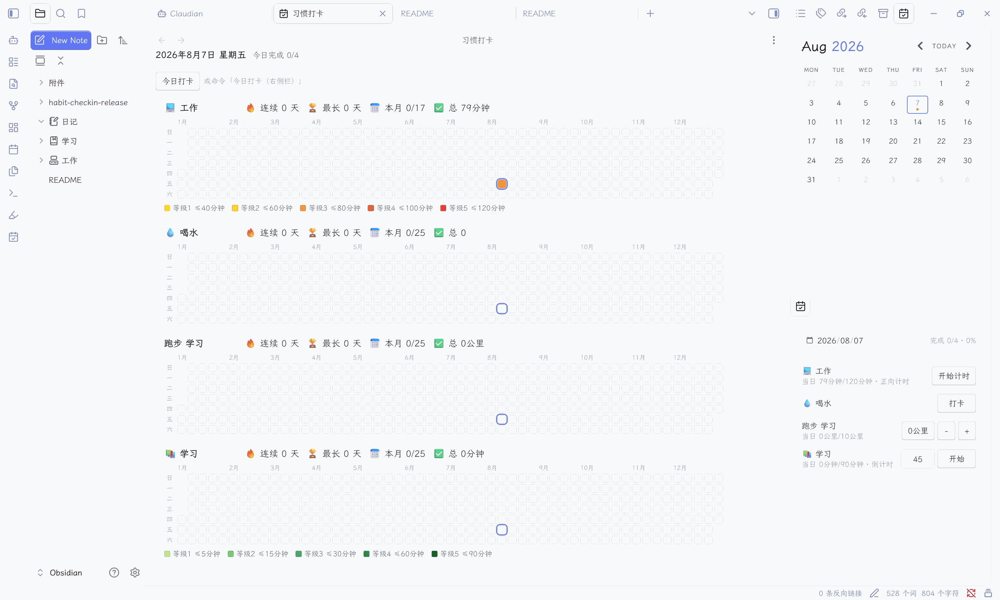
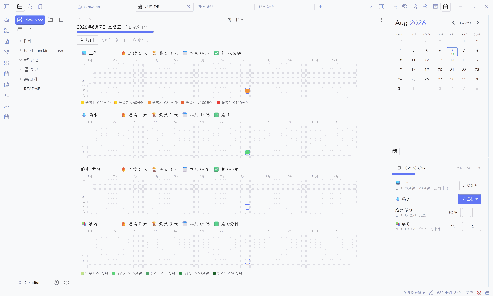
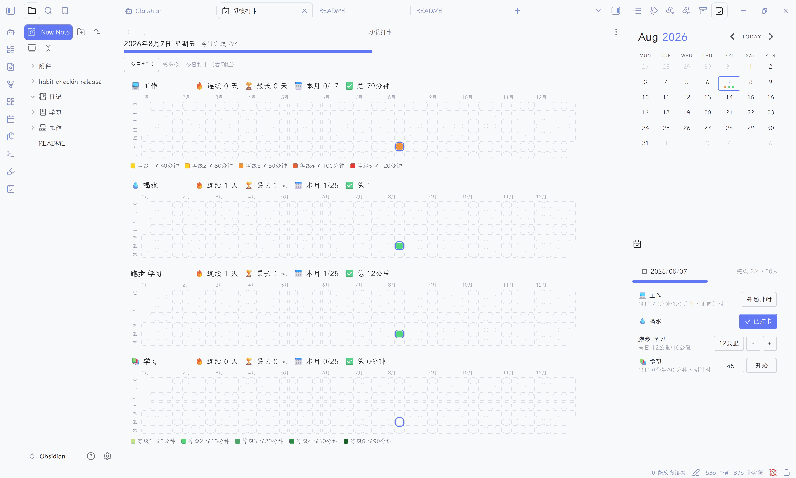
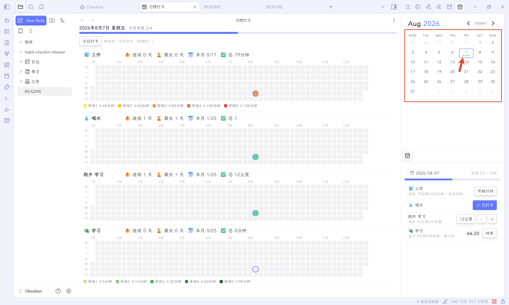
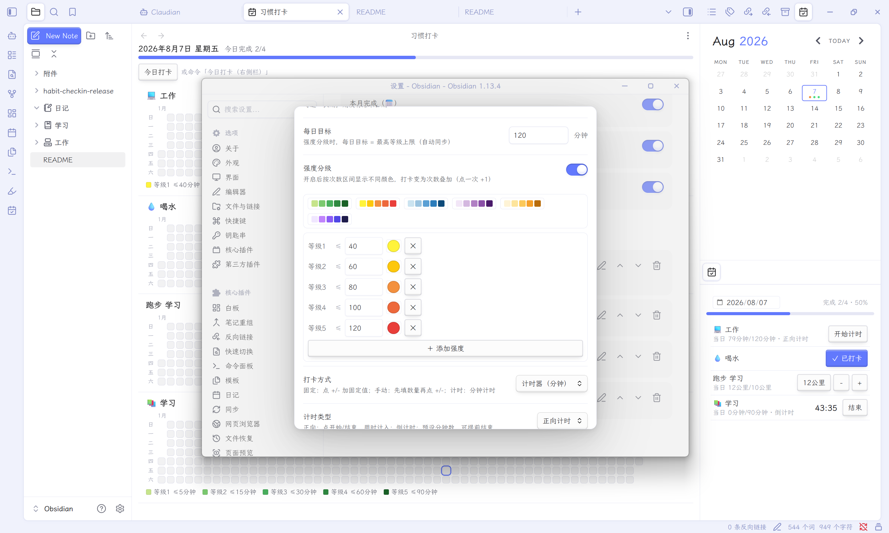
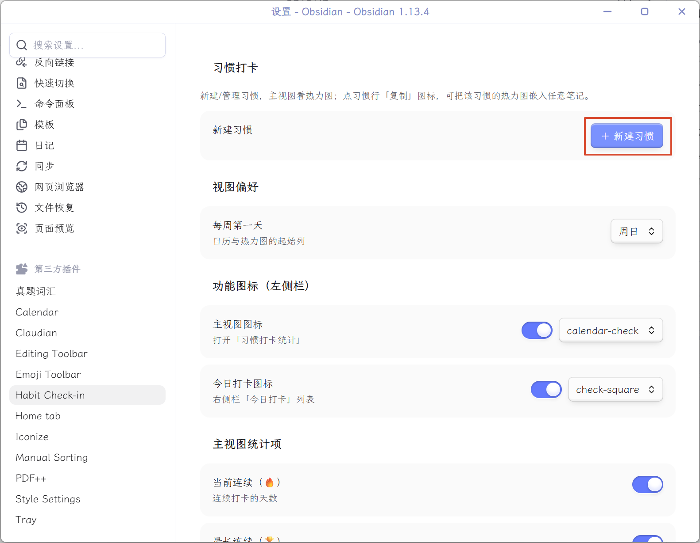
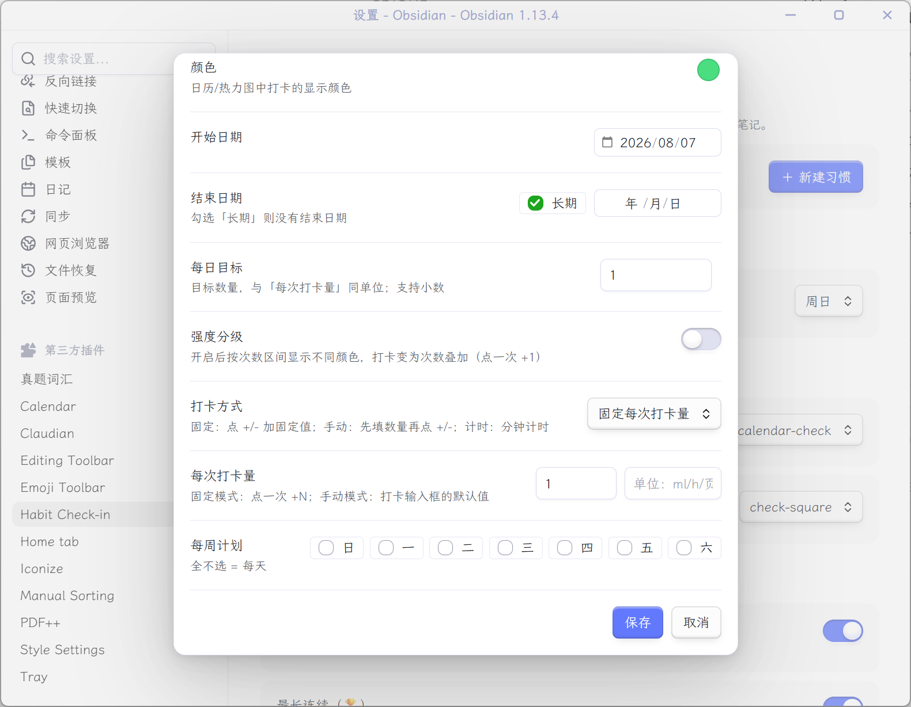
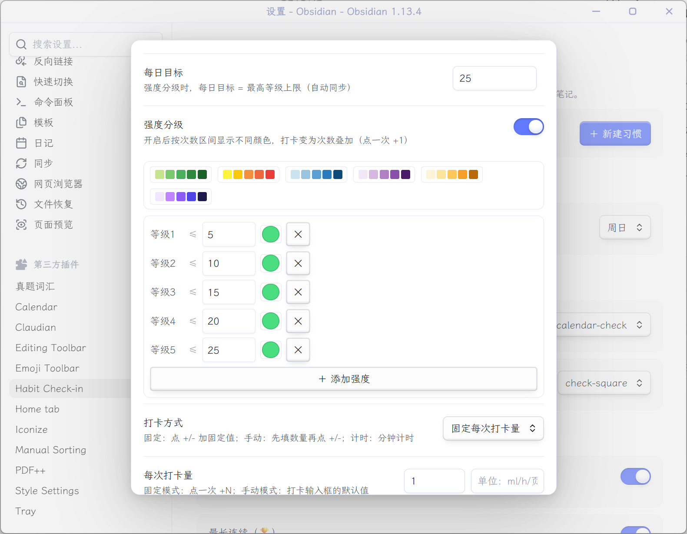
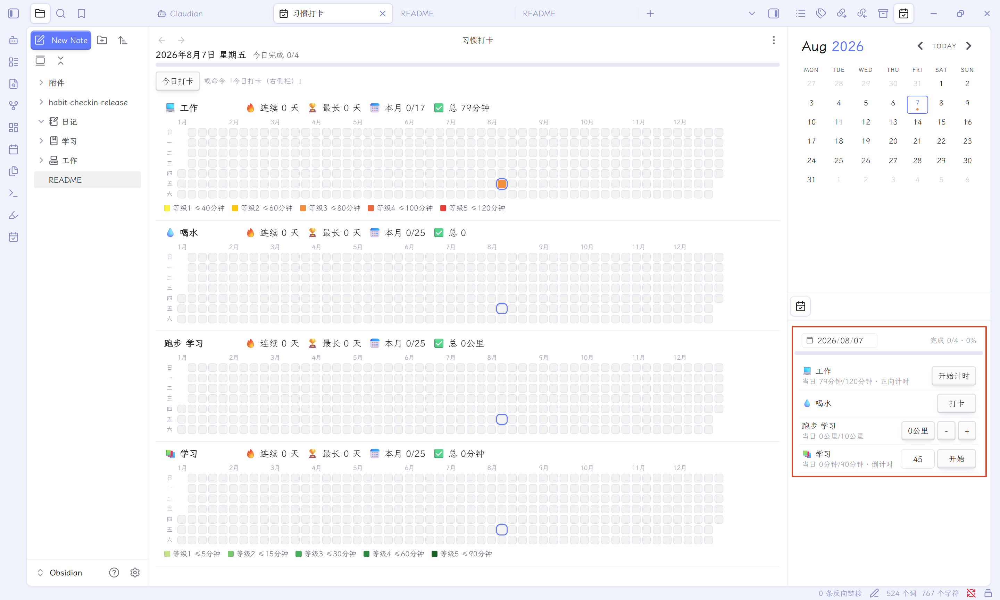

<p align="center"><a href="README-en.md"><strong>English</strong></a> &nbsp;·&nbsp; 🌐 <strong>中文</strong></p>

---

# 习惯打卡 Habit Check-in

> 一款 Obsidian 插件：在右侧栏**一键打卡**，支持 **单次 / 目标 / 计时** 三种打卡方式，自带 **GitHub 风格热力图**、**强度分级配色**，可与 **Calendar 插件联动**，还能把热力图**嵌入任意笔记**。



## ✨ 功能特性

### 1. 多种打卡方式

**① 单次打卡**
设置每日打卡事项，点击打卡按钮即可切换"已打卡 / 未打卡"状态。



**② 目标打卡**
设置每日打卡目标，例如"每天喝水 1000ml"。可以自定义每次打卡的饮水量，点击 **+** 号累加，也可以手动输入单次打卡量。



**③ 时间打卡**
支持**正向计时**与**倒计时**两种模式。倒计时可自定义时长（如 45 分钟），点击"开始"进入倒计时，时间结束自动把统计时长计入打卡。



### 2. 与 Calendar 插件联动

当日完成打卡后，日历对应日期会自动打点标记，一目了然。



### 3. 强度分级配色

可自由添加强度分级，并为每一级设置对应的数值范围与颜色，热力图会按强度自动着色。



## 📦 安装方式

> 前置条件：Obsidian **1.2.0 及以上**版本。

### 方式一：社区插件市场（推荐，最简单）

1. 打开 Obsidian → 设置 ⚙️ → **第三方插件**
2. 关闭"安全模式"（如未关闭），点击 **浏览**
3. 搜索 **`Habit Check-in`**
4. 点击 **安装**，安装完成后在"已安装插件"列表中找到它并**启用**
5. （可选）点击插件名旁的 ⚙️ 图标进入设置页

### 方式二：BRAT（抢先体验新版本）

适用于想第一时间试新功能的朋友。

1. 先安装社区插件 [BRAT](obsidian://show-plugin?id=obsidian42-brat)
2. 命令面板（Ctrl/Cmd+P）→ `BRAT: Add a beta plugin for testing`
3. 粘贴仓库地址：`https://github.com/NotStudyToday/obsidian-habit-check-in`
4. 回到"第三方插件"列表，启用 **Habit Check-in**

### 方式三：手动安装

1. 前往 GitHub [Releases](https://github.com/NotStudyToday/obsidian-habit-check-in/releases) 下载最新版本
2. 解压得到 `habit-checkin` 文件夹（内含 `main.js`、`manifest.json`、`styles.css`）
3. 把文件夹放入 vault 根目录的 `.obsidian/plugins/` 下
4. 重启 Obsidian（或按 Ctrl/Cmd + R 重载），在"第三方插件"中启用

## 🚀 使用教程

### 创建习惯

1. 设置 → **Habit Check-in** → **+ 新建习惯**



2. 填写基本信息：**名称**、**图标**（支持 Emoji）、**打卡方式**、**每次打卡量**等。



3. 如需强度分级：打开"强度分级"开关，设置对应的**等级、数值、颜色**。



4. 点击**保存**即创建成功，之后只需在**右侧栏**打卡即可。



### 查看统计

点击左侧 Ribbon 栏的 **日历图标** 打开主视图，查看每个习惯的**年度热力图**与**连续打卡统计**。热力图支持 **全年 / 近三月 / 当月** 三种范围切换。

### 补卡

忘记打卡？在右侧栏顶部把**日期切换到过去某天**，即可补打当天的卡。

## 📝 在笔记中嵌入热力图

在设置页点击习惯行上的**复制**图标，把代码块粘贴到任意笔记中：

````markdown
```habit-heatmap
habitId=xxxxxxxx
```
````

| 参数 | 可选值 | 说明 |
|------|--------|------|
| `habitId` | 习惯 ID / `all` | `all` 或省略 = 所有习惯 |
| `range` | `year` / `3m` / `month` | 全年（默认）/ 近三月 / 当月 |

嵌入的热力图与打卡数据**实时联动**，打卡后自动更新。

## 💾 数据存储

打卡数据保存在 vault 的 `.obsidian/plugins/habit-checkin/data.json`（首次使用时自动生成）。备份 vault 或直接复制该文件即可。**计时中的任务会在关闭 Obsidian 后自动保存**，下次打开自动结算，不会丢。

## ❓ 常见问题

- **找不到插件？** 先确认 Obsidian 版本 ≥ 1.2.0，且安装后在"已安装插件"列表中已启用。
- **强度颜色不生效？** 需要在创建习惯时打开"强度分级"开关并保存后才会按级着色。
- **想反馈 Bug 或提需求？** 欢迎到 GitHub [Issues](https://github.com/NotStudyToday/obsidian-habit-check-in/issues) 留言 ⭐

---

*插件已上架 Obsidian 官方社区插件市场 🎉 如果你觉得好用，欢迎到 GitHub 点个 Star！*

## License

MIT
